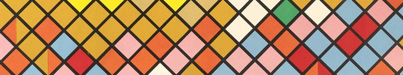

 <!-- Replace the placeholders marked below with your own links and interests -->

<!-- HEADER -->
[)](https://git.io/typing-svg)
<!-- ABOUT ME -->
<h2 align="center">✦ A little about me ✦</h2>

  Hey there! I'm <b>Carla Marcos</b>, also known as <b>Spectra823</b> 👋
   
  I'm a math and physics enthusiast who loves exploring ideas,
  solving problems, and turning curiosity into code.
    
  🔭 Always experimenting with new ideas and personal projects.
   
  🧠 Fascinated by music, mathematics, physics, and quantum computing.
   
  🌍 Based in Salamanca, Spain.
   
  🌐 Spanish · English · French
   
  ❤️ 🖤 Member of the Femenine Tuna of Salamanca, bandurria-player and singer.
    

  
  
  

  

---

<!-- PROJECTS -->
<h2 align="center">✦ Things I'm building ✦</h2>

<table>
  <tr>
    <td width="50%" valign="top">
      <h3>🩺 MelAdvisor</h3>
      

        A melanoma image classification project exploring the use of image analysis and machine learning in skin lesion classification.
      

      

        
      

    </td>
    <td width="50%" valign="top">
      <h3>🎵 Aladin</h3>
      

        A music analyzer and transcript generator, built specifically for tunas all around the world, supporting bandurria, lute and guitar.
      

      

        
      

    </td>
  </tr>
</table>

  <i>Building things at the intersection of technology, science, and creativity. 🚀</i>

---

<!-- TECH STACK -->
<h2 align="center">✦ Tools of the trade ✦</h2>

  <i>Languages, tools, and technologies I use to bring ideas to life.</i>

<h3 align="center">Languages & scientific computing</h3>

  
  
  
  

<h3 align="center">Frameworks & environment</h3>

  
  

---

<!-- SPOTIFY -->
<h2 align="center">✦ Currently on repeat ✦</h2>

  

  <i>🎧 If I'm not listening to music I'm probably asleep </i>

<!-- END -->

